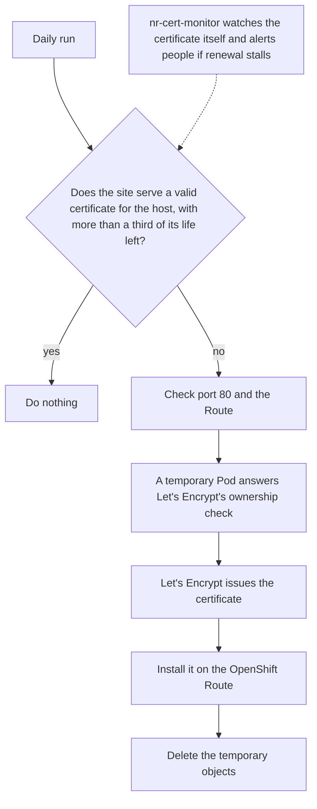

# Cert Keeper

Keeps one hostname's SSL/TLS certificate valid on an OpenShift Route. When the host has no certificate of its own, or is running low, it gets a free [Let's Encrypt](https://letsencrypt.org/) certificate, installs it on your Route, and cleans up. No Service Desk ticket and no paid certificate per renewal, once the host's DNS already points at the cluster router.

Each repo opts in and runs it for its own hosts. Out of scope: wildcards and DNS-01 (see `bcgov/cert-manager-proxy`), several hosts on one certificate, platforms other than OpenShift Routes, and replacing Entrust where a ministry requires it.

## In plain words

Every hostname served over HTTPS needs a certificate, and certificates expire. Getting one by hand means a Service Desk ticket and a paid certificate, and the maximum lifetime keeps shrinking: 90 days now, 64 from February 2027 and 45 from February 2028 (Let's Encrypt's schedule), and 47 days by industry rule from March 2029. By then that is roughly a dozen renewals a year for every host.

`cert-keeper` does the renewing. Once a day, a scheduled workflow in your repo looks at the certificate your site is actually serving. If it is fine, nothing happens. If the host has no certificate of its own, or the certificate has a third of its life or less left, `cert-keeper` gets a free certificate from Let's Encrypt, installs it on your OpenShift Route, and cleans up after itself.

To issue a certificate, Let's Encrypt wants proof that you control the hostname. `cert-keeper` gives it by starting a small temporary Pod in your namespace that answers Let's Encrypt's check over plain HTTP, then deleting it. That is why it needs no cluster admin and no access to DNS: only an OpenShift token for your own namespace.



## How it decides

Every run first reads the certificate the host serves today and does nothing unless one of these is true:

| Situation | What it means |
|---|---|
| The served certificate does not cover the host | A new host: with no Route of its own it is served the router's default wildcard certificate |
| The certificate has expired | Renewal was missed |
| A third of its own lifetime or less is left | Time to renew |
| `force: true` | Reissue now, for example after a private key leak |

The "third" comes from each certificate's own lifetime, so one rule fits every length: renewal starts at about 66 days left on a 198 day certificate, 30 on 90, 21 on 64, and 15 to 16 on 45 to 47. Let's Encrypt moves its default to 64 days on 2027-02-10 and 45 days on 2028-02-16 ([schedule](https://letsencrypt.org/2025/12/02/from-90-to-45)), and industry rules cap lifetimes at 47 days from 2029-03-15 ([lifetimes](https://letsencrypt.org/docs/cert-lifetimes/)). At 47 days that is about one renewal a month.

When a certificate is due:

1. Checks that plain HTTP on port 80 answers for the host (any answer, even a redirect or a 503). Without it, validation cannot work, so it fails early with the reason.
2. Logs in through [`oc-runner`](../oc-runner) and checks the Route (see [What it touches](#what-it-touches)) before spending a certificate.
3. Creates a throwaway Pod (`lego` plus an idle helper), Service, NetworkPolicy and Route named `cert-keeper-<hash>`, labelled `app.kubernetes.io/managed-by=cert-keeper`.
   - The Route is **plain HTTP** with `path: /.well-known/acme-challenge` on the same host. The router prefers the longer path, so the vanity Route (edge plus `Redirect`) keeps serving everything else.
   - The NetworkPolicy lets the OpenShift router reach the Pod in default-deny namespaces.
   - lego waits 20 s after starting so the router can load the Route before validation.
   - If the host is owned by a Route in another namespace the challenge Route is not admitted and the action fails fast.
4. Waits for lego (`timeout`, default 300 s), copies the PEMs out with `oc exec` (retried for up to 15 minutes through API drops, with the Pod kept alive that long), and checks the leaf matches the host.
5. Deletes the Pod, Service, NetworkPolicy and Route on success **and** failure. If a runner dies mid-run, sweep with `oc delete route,service,pod,networkpolicy -l app.kubernetes.io/managed-by=cert-keeper`.
6. Installs the certificate: it checks the certificate, key and chain, creates the Route if it does not exist, saves the old certificate as a backup Secret, applies the new one and reads it back to confirm.

The ACME account key is ephemeral (one per run). Both containers use `goacme/lego`, pinned by digest.

## What it touches

- **One namespace:** `oc_namespace`, and only what the token allows. Nothing outside it.
- **Temporary objects:** the `cert-keeper-<hash>` Pod, Service, NetworkPolicy and challenge Route, deleted at the end.
- **One Route:** `route_name`, which the install step rewrites whole: the host, the backend service, and edge TLS with an HTTP redirect. So before it spends a certificate, `cert-keeper` refuses if that Route already exists and serves a different host, or terminates TLS as `passthrough` or `reencrypt`. A different backend service only warns. A Route that does not exist yet is created.
- **Other Routes:** never changed. A host already claimed by a different Route name stops the install.
- **Any public hostname works,** not only `*.nrs.gov.bc.ca`: one lowercase FQDN whose DNS points at this cluster's router, with port 80 reachable. A host whose DNS points elsewhere fails validation and leaves nothing behind. Call the action once per host; wildcards are not supported.

## Add a host, step by step

1. **DNS and port 80.** The host's A or CNAME record must already point at the cluster router (a one-time Service Desk step for a new name), and plain HTTP on port 80 must reach it.
2. **Create a GitHub Environment** named `prod` in the repo's Settings, then set its variables and secret. The OpenShift API address is the same for every Silver namespace; the rest are yours.

   ```bash
   gh variable set VANITY_HOST  --env prod --body "myapp.nrs.gov.bc.ca"
   gh variable set OC_NAMESPACE --env prod --body "abc123-prod"
   gh variable set OC_SERVER    --env prod --body "https://api.silver.devops.gov.bc.ca:6443"
   gh secret set OC_TOKEN --env prod   # paste the token when prompted
   ```

3. **Token permissions.** The token for `OC_NAMESPACE` must be able to create, get and delete pods, services, routes and networkpolicies, to exec into pods and read their logs, and to create secrets (the install step saves the old certificate as a backup Secret). Events are listed for diagnostics only.
4. **Add the workflow** from [Usage](#usage) as `.github/workflows/cert-keeper.yml`, with your own Route and Service names, in a pull request.
5. **First run.** Run it from the Actions tab. By default it asks for a real, browser-trusted certificate. To rehearse first, add `ca: letsencrypt-staging`, but be careful: staging installs an **untrusted** certificate on the Route, so browsers show a warning. The daily check only looks at dates and the host name, so it will not replace that certificate until a third of its life is left. After a rehearsal, run once with `force: true` and the default `ca` to put a trusted certificate back. Use staging only on a host nobody is using yet.
6. **Check it worked.** `ssl_verify=0` means the certificate is trusted:

   ```bash
   curl -sS -o /dev/null -w 'http=%{http_code} ssl_verify=%{ssl_verify_result}\n' https://myapp.nrs.gov.bc.ca/
   ```

7. **Optional second pair of eyes.** Add the host to [`nr-cert-monitor`](https://github.com/bcgov/nr-cert-monitor) with a pull request to its `rules.yml`.

## Usage

Run it from its own scheduled workflow, daily. The check is cheap and does nothing when the certificate is fine, and a daily schedule tolerates GitHub dropping a run. Never put it in `merge.yml` or deploy pipelines. A complete `.github/workflows/cert-keeper.yml`:

```yaml
name: Cert Keeper

on:
  schedule:
    - cron: "17 15 * * *" # daily, 08:17 PT
  workflow_dispatch:
    inputs:
      force:
        description: Get a new certificate even if the current one is not due
        type: boolean
        default: false

concurrency:
  group: cert-keeper
  cancel-in-progress: false

permissions: {}

jobs:
  cert-keeper:
    name: Keep certificate valid
    environment: prod
    runs-on: ubuntu-24.04
    permissions:
      contents: read
      issues: write
    timeout-minutes: 15
    steps:
      # workflow-notifier reads CODEOWNERS from the workspace
      - uses: actions/checkout@3d3c42e5aac5ba805825da76410c181273ba90b1 # v7.0.1
        with:
          persist-credentials: false

      - uses: bcgov/actions-openshift/cert-keeper@<sha> # vX.Y.Z
        with:
          hostname: ${{ vars.VANITY_HOST }}
          route_name: ${{ github.event.repository.name }}-vanity-url
          target_service: ${{ github.event.repository.name }}-prod-frontend
          force: ${{ inputs.force || 'false' }}
          oc_namespace: ${{ vars.OC_NAMESPACE }}
          oc_server: ${{ vars.OC_SERVER }}
          oc_token: ${{ secrets.OC_TOKEN }}

      - name: Notify CODEOWNERS
        if: failure()
        uses: bcgov/actions/workflow-notifier@4026bfd276b8a5839029106099b13edfb594b2c3 # v0.8.0
        with:
          title: "Certificate renewal failed"
          labels: ""
          notify_author: "false"
          notify_codeowners: "true"
```

Pin to a release SHA, never `@main`. Also add the host to [`nr-cert-monitor`](https://github.com/bcgov/nr-cert-monitor) if you want a second set of eyes: it checks the certificate itself, so it still alerts if this workflow stops running.

### Before the first run on a new host

- The host's A or CNAME record already points at the cluster router (a one-time Service Desk step).
- Plain HTTP on port 80 reaches the router.
- No Route in another namespace already claims the host.
- To rehearse, `ca: letsencrypt-staging` proves it end to end, but it installs an untrusted certificate on the Route that the daily check will not replace on its own (run once with `force: true` afterwards), so use it only on a host nobody is using yet.

## Inputs

| Input | Required | Default | Notes |
|---|---|---|---|
| `hostname` | yes | | One lowercase FQDN, no scheme, port or wildcard |
| `email` | no | none | Optional contact for the ACME account. Let's Encrypt no longer sends expiry emails and each run uses a new account, so leave it out unless you want one |
| `route_name` | yes | | Route to create or update |
| `target_service` | yes | | Service the Route sends traffic to |
| `ca` | no | `letsencrypt` | `letsencrypt` or `letsencrypt-staging`. An omitted value selects production |
| `force` | no | `false` | Reissue now even if not due |
| `timeout` | no | `300` | Seconds to wait for issuance, at least 30 |
| `oc_namespace`, `oc_server`, `oc_token` | yes | | The token needs create, get and delete on pods, services, routes and networkpolicies, `pods/exec`, pod logs, and create on secrets (see [Add a host](#add-a-host-step-by-step)) |

## Outputs

| Output | Meaning |
|---|---|
| `due` | `true` when a certificate was needed (and so issued and installed), `false` when the current one was left alone |
| `reason` | Why |
| `not_after` | Expiry of the new certificate; empty when nothing was issued |

## Limits

### Let's Encrypt's limits

These come from Let's Encrypt's [rate limits page](https://letsencrypt.org/docs/rate-limits/).

| Limit | Allowance | Who shares it | In practice |
|---|---|---|---|
| Certificates for one exact hostname | 5 per 7 days, one more every 34 hours | Everyone, for that hostname | Renewals count. A normal host uses about one a month. Repeated `force` runs or testing can use it up. No override. |
| New certificates per registered domain | 50 per 7 days, one more every 202 minutes | Everyone under `gov.bc.ca`, across all accounts | `bc.ca` is on the Public Suffix List, so the whole province shares this one. Renewals do not count, only first-time names. An override form exists and takes weeks. |
| New accounts per IP address | 10 per 3 hours | Everyone on that IP | Each run that issues registers a fresh account from a GitHub runner, and runner IPs are shared. No override. |
| Failed validations | 5 per hour per host, counted per account | Per host and account | `cert-keeper` registers a new account every run, so one run's failures do not carry over to the next and this rarely bites. It matters if you run `lego` by hand with one account while debugging. |

### Limits of `cert-keeper` itself

- **One hostname per run.** No wildcards. Call it once per host.
- **HTTP-01 on OpenShift Routes only.** The host must be public, its DNS must point at the cluster router, and port 80 must be reachable.
- **Shrinking lifetimes.** The one-third rule adapts, but renewals become more frequent as certificates get shorter.
- **OpenShift API reliability.** The connection from GitHub runners to the API has dropped during testing. `cert-keeper` retries for up to 15 minutes while copying the certificate out, and the install step retries network errors up to 12 times. A longer outage fails that run: the current certificate keeps serving, the code owners are alerted, and the next daily run tries again.
- **Scheduling.** GitHub can delay or drop scheduled runs, and disables schedules in public repos after 60 days without activity.
- **Dependencies.** The cluster pulls the `lego` image from Docker Hub, pinned by digest.
- **Policy.** Whether Let's Encrypt is approved for your domain is for your organization to settle; `cert-keeper` does not decide it.

## Rolling it out

- Only first-time names count against the shared 50 a week, so adding many new hosts in one week is what can reach it. Renewals do not.
- Pick your own minute in the `cron` line, so repos do not all run at the same moment.
- Rehearse on a host nobody is using before a real one, and do not use `force` to test, because it spends the per-host allowance.
- Add each host to `nr-cert-monitor` so a stalled renewal is noticed.

## FAQ

**Why not cert-manager or another existing tool?** Cluster-side controllers such as cert-manager or `openshift-routes` need a cluster admin to install, which app teams normally do not have. If your cluster provides one, prefer it. The namespace-level controller `openshift-acme` is archived, and ACME clients run from GitHub usually answer the challenge through DNS, which most teams here cannot change.

**What if it fails?** The run fails, the code owners get an issue from `workflow-notifier`, the current certificate keeps serving, and the next daily run tries again. Renewal starts at about 15 days left on a 47 day certificate, so there are roughly two weeks of daily tries.

**Is Let's Encrypt allowed for my domain?** That is an organizational decision, not something this action can answer. For Natural Resources the question is tracked in [#159](https://github.com/bcgov/actions-openshift/issues/159).

**Can it use another certificate authority?** Today `ca` accepts `letsencrypt` and `letsencrypt-staging`. Another ACME authority would be a change to the action, and some need extra credentials.

**What happens to my current certificate?** It stays until the new one is installed. the install step saves the old one as a backup Secret first.

**How do I stop it?** Disable the workflow. The current certificate stays on the Route until it expires.

## Common fixes

| Message | Fix |
|---|---|
| `Port 80 on <host> did not answer` | Point the host at the OpenShift router and allow plain HTTP on port 80 |
| `Could not read a certificate for <host> over TLS` | The host does not resolve to the router, or port 443 is blocked |
| `Pod ... cannot start` | The log prints the container state and events; fix the cause they name |
| `challenge Route ... was not admitted` | Another namespace owns the host |
| `lego did not finish within ...s` | DNS for the host must reach this cluster's router; the log prints events |

## Local run

```bash
oc login ... && ACME_HOST=app.example.gov.bc.ca CA=letsencrypt-staging ./issue.sh
RENDER_ONLY=true ACME_HOST=... ./issue.sh   # print the manifests only
```
